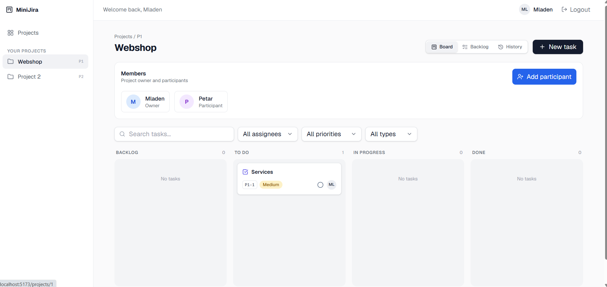
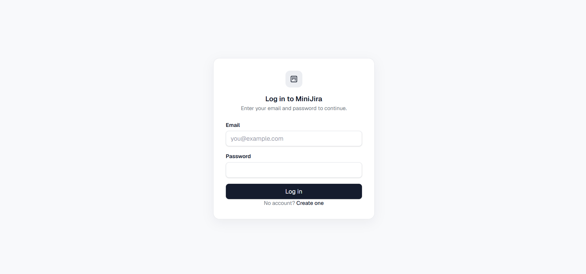
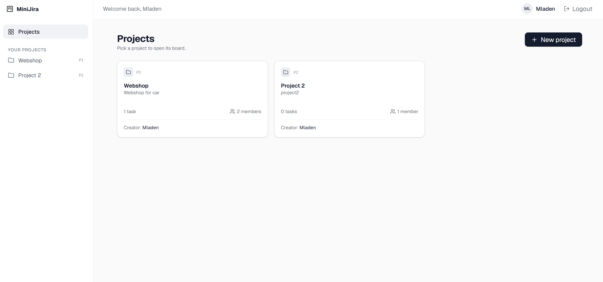
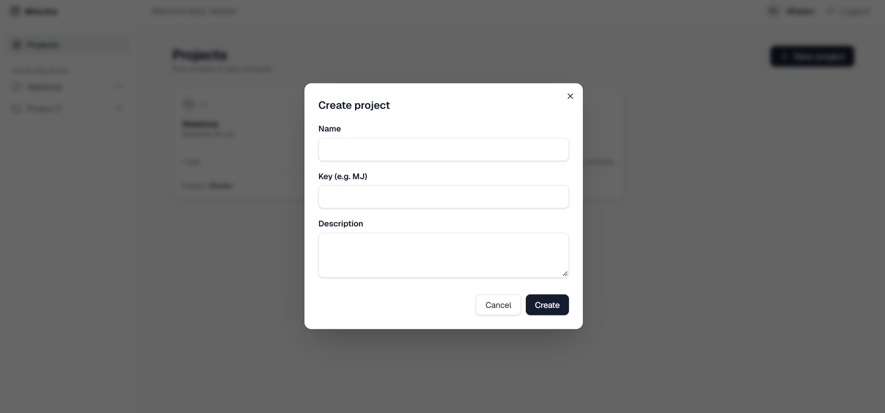
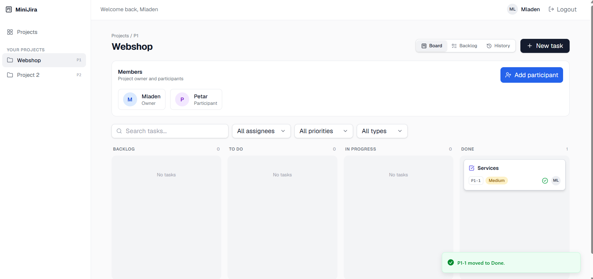
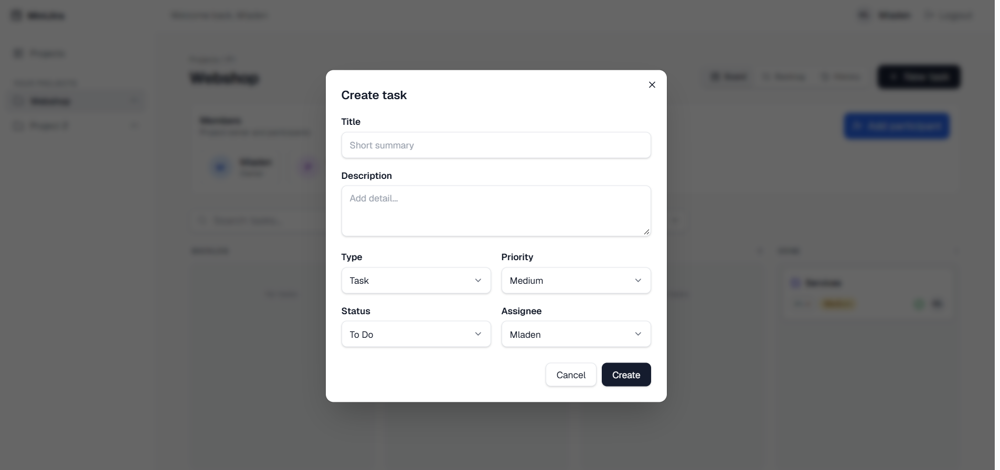
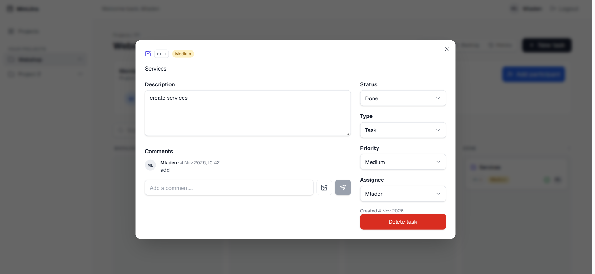
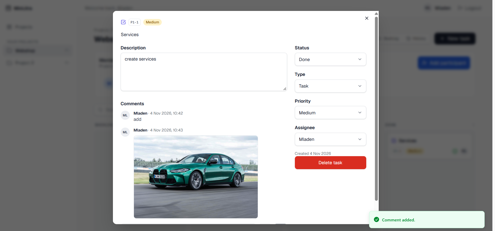
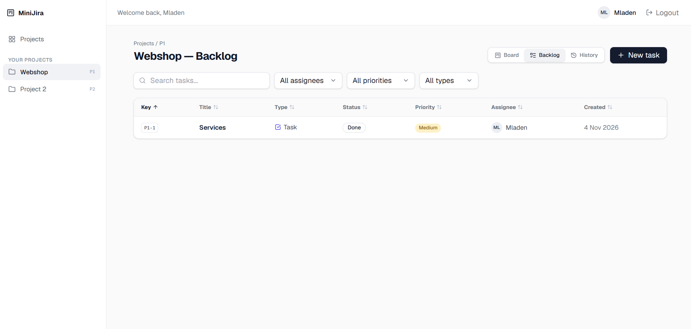
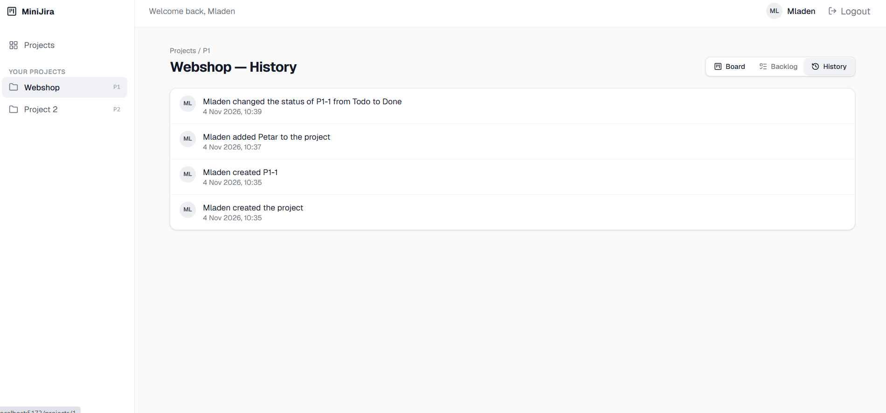

# 🗂️ MiniJira

<p align="center">
  <strong>Full-stack project and task management application inspired by Jira.</strong>
</p>

<p align="center">
  Create private projects, add participants, manage tasks on a Kanban board and in a backlog table,
  discuss work through comments with images and follow every change in the project history.
</p>

<p align="center">
  
  
  
  
  
  
</p>

<p align="center">
  
</p>

---

## 📌 Overview

**MiniJira** is a full-stack web application for managing projects and tasks, built with a **Spring Boot** backend and a **React + TypeScript** frontend.

Every project is private. Only the project owner and the participants added by the owner can see the project, create tasks and write comments. Work is organized on a Kanban board with drag & drop and in a sortable backlog table, while all important changes are recorded in a project history.

---

## ✨ Main Features

### 🔐 Authentication & Access

- User registration and login
- JWT-based authentication
- Private projects visible only to the owner and participants
- Project members management (owner and participants)

### 🗂️ Projects

- Create projects with a name, a short key and a description
- Overview of all available projects with task and member counts
- Project key used for task identifiers (for example `P1-1`)
- Add participants to a project

### 📋 Tasks

- Kanban board with Backlog, To Do, In Progress and Done columns
- Drag & drop of tasks between columns
- Create tasks with title, description, type, priority, status and assignee
- Edit task details in a dedicated dialog
- Delete tasks
- Search and filter by assignee, priority and type
- Backlog table with sortable columns

### 💬 Collaboration

- Comments on tasks
- Image attachments in comments
- Instant feedback notifications for actions such as moving a task or adding a comment

### 🕘 History

- Project activity log
- Records who created a project or task, added a participant or changed a status, and when

---

## 🛠️ Technology Stack

### Backend

<p>
  
  
  
  
  
</p>

The backend exposes REST endpoints, secures them with **Spring Security and JWT**, and stores data in **SQL Server** through JPA. It is a **Maven multi-module** project organized by **clean architecture**.

### Frontend

<p>
  
  
  
  
  
</p>

The client is built with **React, TypeScript and Vite**, styled with **Tailwind CSS and shadcn/ui**, uses **axios** for API communication and **dnd-kit** for drag & drop.

---

## 🏗️ Application Structure

```text
MiniJira
│
├── backend  (Maven multi-module)
│   ├── domain           Entities and business rules
│   ├── application      Use cases and services
│   ├── infrastructure   JPA persistence and external concerns
│   ├── presentation     REST controllers and security
│   └── app              Application entry point
│
└── frontend (React + Vite + TypeScript)
    ├── Authentication
    ├── Projects
    ├── Board
    ├── Backlog
    ├── Task details & comments
    └── History
```

---

# 📸 Application Preview

## 🔐 Login

Users sign in with their email and password, or create a new account.

<p align="center">
  
</p>

---

## 🗂️ Projects

The projects screen lists every project the user owns or participates in. New projects are created with a name, a key and a description.

<table>
  <tr>
    <td width="50%" align="center">
      <strong>Projects Overview</strong><br><br>
      
    </td>
    <td width="50%" align="center">
      <strong>Create Project</strong><br><br>
      
    </td>
  </tr>
</table>

---

## 📋 Kanban Board

The board shows the project members and tasks grouped by status. Tasks can be searched and filtered, and the owner can add participants. Moving a task between columns with drag & drop saves the new status immediately.

<table>
  <tr>
    <td width="50%" align="center">
      <strong>Board</strong><br><br>
      
    </td>
    <td width="50%" align="center">
      <strong>Drag & Drop</strong><br><br>
      
    </td>
  </tr>
</table>

---

## ✅ Tasks

Tasks are created with a title, description, type, priority, status and assignee, and can be edited later in the task details dialog.

<table>
  <tr>
    <td width="50%" align="center">
      <strong>Create Task</strong><br><br>
      
    </td>
    <td width="50%" align="center">
      <strong>Task Details</strong><br><br>
      
    </td>
  </tr>
</table>

---

## 💬 Comments

Each task has its own discussion. Comments can contain text and images.

<p align="center">
  
</p>

---

## 📑 Backlog

All tasks of a project are available in a table with sortable columns for key, title, type, status, priority, assignee and creation date.

<p align="center">
  
</p>

---

## 🕘 History

Every important change in a project is stored with its author and time, which gives the team a clear overview of what happened and who did it.

<p align="center">
  
</p>

---

## 🔄 Main Application Flow

```text
Login / Registration
    │
    ▼
Projects
    │
    ├── Create Project
    │       └── Add Participants
    │
    ▼
Project
    │
    ├── Board
    │       ├── Create Task
    │       ├── Drag & Drop Between Columns
    │       └── Task Details
    │               └── Comments (text and images)
    │
    ├── Backlog
    │
    └── History
```

---

## 📂 Main Functional Modules

| Module | Responsibility |
|---|---|
| **Authentication** | Registration, login and JWT security |
| **Projects** | Project creation, ownership and participants |
| **Access Control** | Private projects for owner and participants only |
| **Board** | Kanban columns, drag & drop, search and filters |
| **Tasks** | Creating, editing and deleting tasks |
| **Comments** | Task discussion with text and images |
| **Backlog** | Sortable table of all project tasks |
| **History** | Activity log of changes in a project |

---

## 🚀 Getting Started

### Prerequisites

- Java 17+ and Maven
- Node.js 18+
- A running SQL Server instance

### Clone the Repository

```bash
git clone https://github.com/mladenjeremic/MiniJira.git
cd MiniJira
```

### Backend

Configure the database connection and the JWT secret in the backend application properties, then run:

```bash
cd backend
mvn clean install
mvn spring-boot:run -pl app
```

### Frontend

```bash
cd frontend
npm install
npm run dev
```

The frontend runs on `http://localhost:5173`.

> Never commit database passwords, JWT secrets or other private credentials to the repository.

---

## 🎯 Engineering Focus

This project demonstrates practical experience with:

- Java and Spring Boot backend development
- REST API design
- Authentication and authorization with Spring Security and JWT
- Relational database access with JPA and SQL Server
- Clean architecture and Maven multi-module projects
- React and TypeScript frontend development
- Drag & drop interfaces
- Private, role-aware project access
- Activity logging
- Git-based version control

---

## 👨‍💻 Author

### Mladen Jeremić

Information Technology Graduate & Software Developer  
Novi Sad, Serbia

<p>
  <a href="https://github.com/mladenjeremic">
    
  </a>
  <a href="https://www.linkedin.com/in/mladen-jeremic/">
    
  </a>
</p>

---

<p align="center">
  <strong>Full-stack project management application built with Spring Boot, React and SQL Server.</strong>
</p>
